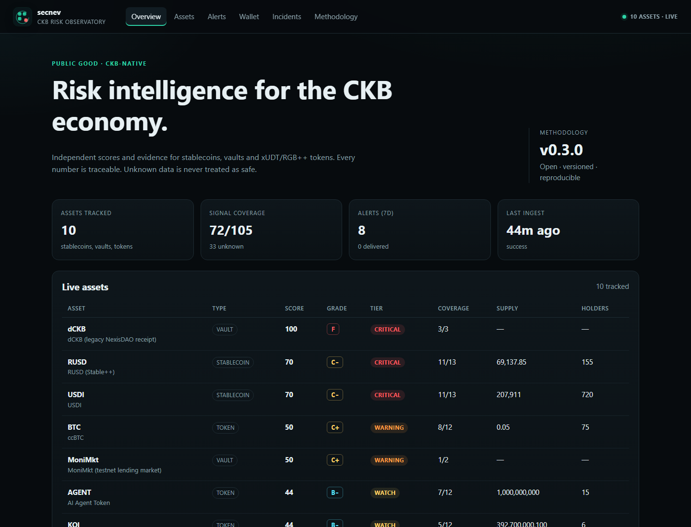
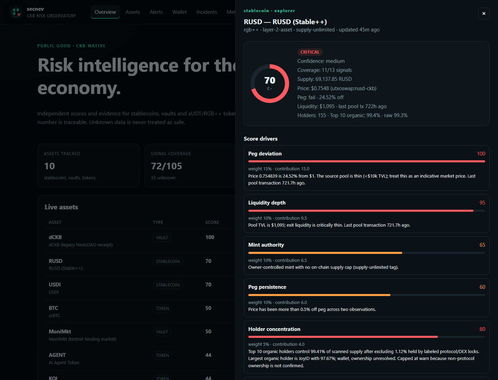
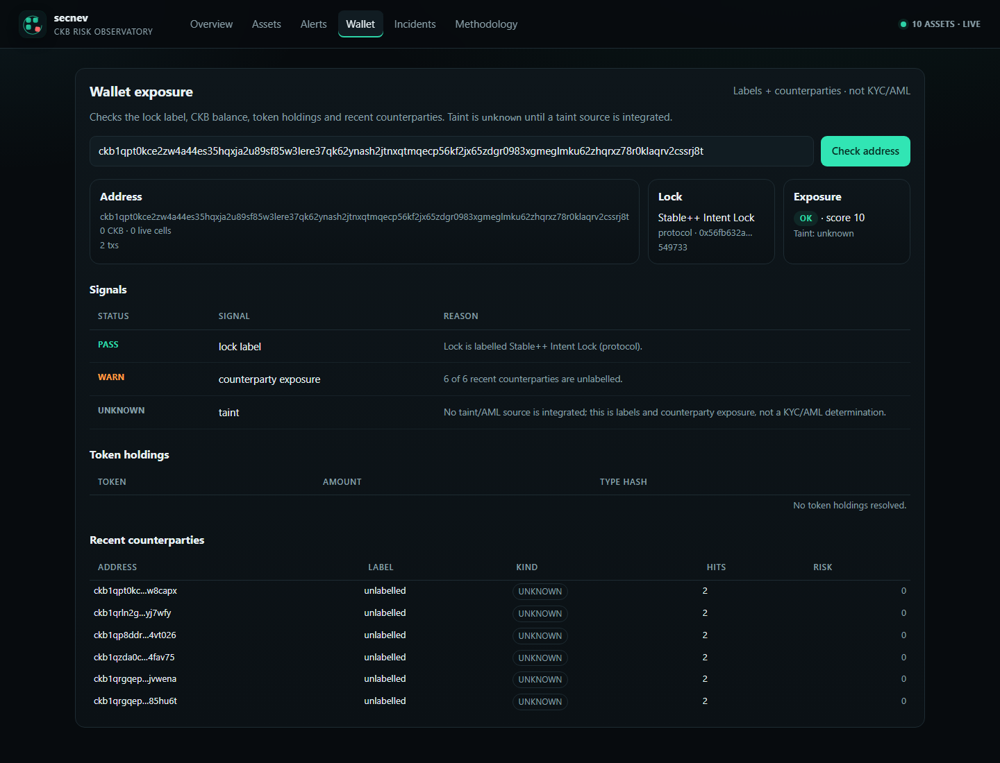

# secnev

**CKB-native risk observatory — open, explainable, public good.**

secnev scores stablecoins, vaults and xUDT/RGB++ tokens on CKB, publishes the evidence, and alerts when conditions change. It is built from the cell model up, not adapted from an EVM engine.

> Status: **MVP working on CKB mainnet.** 10 assets, 105 signal instances: **72 live / 33 unknown**. Live RUSD **and USDI** peg + liquidity from UTXOSwap pool cells (both currently far off peg; both pools are thin/stale), live iCKB exchange rate/backing, organic holder concentration, wallet exposure screening, real historical dCKB replay, full cell scans (no 30-page cap), and webhook/Telegram/email alerts. Stable++ CR/TCR/oracle, MoniMkt positions, AGENT/KOI/iCKB liquidity and taint are deliberately `unknown` — unknown is never treated as safe.







---

## Why

CKB has real assets but no independent risk layer:

- no Tier-1 analytics vendor covers CKB (Elliptic lists `Nervos: No`; Nominis, Bitrace, Merkle Science and MistTrack do not list it; Webacy does not support CKB);
- DefiLlama has no CKB L1 TVL or stablecoin data (only deprecated Godwoken at $0);
- the dCKB drain (~24.6M CKB) and the RGB++ forged-proof incident (16.59M CKB, unnoticed for 80 days, per the ckb-adversary proposal) show what the blind spot costs;
- the only direct attempt, Quantir's 2026 grant proposal, stalled at the discussion stage with no public CKB prototype.

secnev is the missing layer: a free, open, CKB-native risk view.

---

## Quick start

```bash
npm install
npm run ingest     # read CKB mainnet, score 10 assets, write ./data/secnev.db
npm run dev        # http://localhost:8787
```

Other commands:

```bash
npm test           # 15 unit tests (grades, xUDT args, organic concentration, pool math, webhook, Telegram)
npm run typecheck
npm run build
npm run replay     # real dCKB historical transaction replay (fallback: REPLAY_CURATED=1)
npm run ingest     # re-run ingestion (full scans; Seal ~43s)
npm run snapshot   # write data/secnev.snapshot.db for Vercel
npm run webhook:test  # send a test alert to configured channels
```

Environment (`.env.example`):

```bash
PORT=8787
DB_PATH=./data/secnev.db
CKB_RPC_URL=https://mainnet.ckb.dev/
CKB_EXPLORER_URL=https://mainnet-api.explorer.nervos.org/api/v1
ADMIN_TOKEN=change-me
# Optional: UTXOSwap pool/price API fallback (contact developer@utxoswap.xyz).
# The built-in RUSD adapter reads the pool cell directly and needs no key.
UTXOSWAP_API_KEY=
# Optional: outbound alert delivery, HMAC-SHA256 signed
ALERT_WEBHOOK_URL=
ALERT_WEBHOOK_SECRET=
# Optional Telegram
TELEGRAM_BOT_TOKEN=
TELEGRAM_CHAT_ID=
# Optional SMTP email
ALERT_EMAIL_SMTP_HOST=
ALERT_EMAIL_SMTP_PORT=587
ALERT_EMAIL_SMTP_SECURE=0
ALERT_EMAIL_USER=
ALERT_EMAIL_PASS=
ALERT_EMAIL_FROM=
ALERT_EMAIL_TO=
# 0 = full scan until the RPC returns an empty page, bounded by the budget
MAX_CELL_PAGES=0
CELL_SCAN_BUDGET_MS=180000
```

The dashboard is at `/`, the API at `/api/v1`, and the machine-readable methodology at `/api/v1/methodology`.

### Deploy to Vercel (Hobby)

The repo includes `vercel.json`, flat `api/v1/*` functions, and a read-only SQLite snapshot path:

```bash
npm run ingest
npm run snapshot     # writes data/secnev.snapshot.db; commit it
```

Import the repo into Vercel with Framework **Other**, build **`npm run build`**, output **`public`**, Node **24+**. The dashboard/API work immediately from the committed snapshot. For a daily refresh, connect a Vercel Blob store and set `BLOB_READ_WRITE_TOKEN` + `CRON_SECRET`; the daily cron runs `api/cron/ingest.ts`.

Full setup, Hobby limits, and troubleshooting: [`docs/VERCEL.md`](docs/VERCEL.md).

---

## What the MVP does

| Layer | Implemented |
|---|---|
| Ingestion | CKB public RPC `get_cells` + CKB Explorer API; real mainnet cells, supply, holders and lock distribution |
| Assets | RUSD, iCKB, USDI, STB, Seal, AGENT, KOI, ccBTC, dCKB (incident), MoniMkt (testnet) |
| Pool price/liquidity | Live UTXOSwap pool cells for RUSD/CKB, USDI/CKB, STB/CKB, Seal/CKB and BTC/CKB; no API key. Price, TVL, 1%-impact depth and last-pool-tx age |
| Vault state | Live iCKB exchange rate and backing ratio from the iCKB Logic DAO deposits + Explorer supply |
| Holder concentration | Organic: Stable++ Intent Lock and UTXOSwap pool locks excluded; unresolved large holders capped at warn; raw share still published |
| Wallet exposure | `GET /api/v1/wallet/{address}` + Wallet tab: lock label, balance, UDT holdings, recent counterparties, flagged-address exposure; taint stays `unknown` |
| Historical replay | `npm run replay` pages 3,464 real dCKB transactions and fetches full transaction details for candidate movements |
| Detectors | Peg, persistence, supply reconciliation, mint authority, redemption velocity, holder concentration, xUDT extensions, supply cap, incident history, admin/script change, script audit, vault exchange rate/backing/withdrawal/status |
| Scoring | 0–100 risk, A+…F, ok/watch/warning/critical, coverage, confidence, ranked drivers with evidence |
| Surfaces | Web dashboard, REST API, JSON methodology, alert feed, wallet tab |
| Alerts | Tier changes and 20+ point jumps stored with `why_now` + evidence; HMAC webhook + Telegram + SMTP email, retries and a per-channel delivery log |
| Indexer | Full `get_cells` scan by default (0 page cap), 180s budget; Seal completes at 10,662 cells / 108 pages |
| Public good | Apache-2.0 code, CC BY 4.0 data, no token, no paid scores |

### What is deliberately `unknown` in the MVP

- **AGENT/KOI/iCKB liquidity** — no configured pool. RUSD, USDI, STB, Seal and BTC are live from UTXOSwap pool cells.
- **Stable++ CR/TCR/oracle and MoniMkt positions** — protocol-state adapters are still Phase 1. iCKB exchange rate/backing are live.
- **Wallet taint/AML** — the wallet screen is labels + counterparty exposure; it does not claim taint, KYC or AML coverage.
- **Full CKB-deposit reconstruction** — the replay now uses real dCKB transactions and full transaction details, but it does not yet rebuild every NervosDAO deposit behind the drain.
- **Cross-venue spread** — only one live pool per asset; a second independent venue is Phase 1.

This is intentional: the product publishes coverage and confidence so a low-coverage score is visibly low-coverage. Current mix: **72 live / 33 unknown** out of 105 signal instances.

---

## Architecture

```
CKB public RPC (get_cells) ─────────┐
CKB Explorer API ───────────────────┼─> normalize cells/scripts ─> detectors ─> score ─> SQLite
UTXOSwap pool cells (5 pairs) ──────┤                                      │
iCKB Logic DAO deposits ────────────┤                                      ├─> REST API
CoinGecko CKB / manual prices ──────┘                                      ├─> dashboard
                                                                           ├─> wallet screen
                                                                           └─> alerts ─> webhook / Telegram / email
```

### CKB primitives used (from the official docs)

- **Cell model:** a transaction consumes live cells as inputs and creates new cells as outputs; each cell has capacity, a lock script, an optional type script, and data. State changes are cell replacement, not in-place account mutation.
- **xUDT:** assets live across cells; the type script args are `<32-byte owner lock hash> <4-byte flags (LE)> <extension ScriptVec>`. Flags include `0x1FFFFFFF` (extensions), `0x20000000` (owner mode via input lock), `0x40000000` (output type), `0x80000000` (input type). See `src/ckb/address.ts`.
- **Address → script:** `@ckb-ccc/core` parses CKB addresses into lock scripts; `hashCkb(Script.encode(script))` is used for script fingerprints.
- **Amounts:** xUDT/sUDT cell data begins with a 16-byte little-endian u128 (`parseU128LE`).
- **Nervos DAO / iCKB / Stable++:** modelled as vault/stablecoin entities; protocol-specific state is Phase 1.

Docs mirrored locally: `research/nervos/raw/` (`llms-full.txt`, Explorer API pages, Stable++ pages, iCKB README/audit).

---

## API

Base: `/api/v1`

| Method | Path | Purpose |
|---|---|---|
| GET | `/health` | service status |
| GET | `/stats` | assets, scored, alerts, last ingest |
| GET | `/assets` | list with latest score, tier, peg, coverage |
| GET | `/assets/{id}` | detail: score, drivers, signals, snapshot, history |
| GET | `/assets/{id}/history` | score history |
| GET | `/alerts` | alert feed |
| GET | `/incidents` | curated incident registry |
| GET | `/pools` | configured pool identities (RUSD, USDI, STB, Seal, BTC) |
| GET | `/vaults` | configured vault identities (iCKB) |
| GET | `/wallet/{address}` | lock label, balance, UDTs, counterparties, exposure |
| GET | `/methodology` | grades, tiers, weights, thresholds, rules |
| POST | `/ingest` | run ingestion (`x-admin-token`) |

Every score carries:

```json
{
  "score": 38,
  "grade": "B-",
  "tier": "watch",
  "confidence": "medium",
  "coverage": { "live": 7, "total": 13 },
  "drivers": [{ "name": "Mint authority", "score": 65, "weight": 0.1, "reason": "..." }],
  "signals": [{ "id": "peg_deviation", "status": "unknown", "score": null }]
}
```

---

## Repository layout

```
src/
  ckb/address.ts     CKB address -> script, xUDT args parser, script hash
  ckb/rpc.ts         get_cells, u128 parsing, holder/lock aggregation
  explorer.ts        CKB Explorer API client
  labels.ts          lock labels + organic-exclusion policy
  pools.ts           direct pool-cell reader (5 UTXOSwap CKB pairs)
  vaults.ts          iCKB exchange rate + backing from Logic DAO deposits
  wallet.ts          wallet labels + counterparty exposure
  replay.ts          real dCKB historical transaction replay
  notify.ts          Telegram + SMTP email delivery
  price.ts           manual / CoinGecko / pool / UTXOSwap price adapters
  webhook.ts         HMAC webhook + multi-channel delivery orchestration
  registry.ts        asset registry (real type hashes)
  detectors.ts       CKB-native signals
  scoring.ts         weights, grades, tiers, coverage
  ingest.ts          ingest + alert pipeline
  db.ts              SQLite schema and queries
  api.ts / local-server.ts REST API + static dashboard
public/              dashboard (vanilla JS, no build step)
api/                 Vercel functions (flat routes; no catch-all)
config/              assets, labels, pools, audits, incidents, optional prices
data/                live SQLite + committed read-only snapshot for Vercel
vercel.json          Vercel Hobby config (functions, output, daily cron)
tests/               15 unit tests + headless browser smoke test
```

---

## Public-good commitments

- **Apache-2.0** code; **CC BY 4.0** data.
- **No token, no paid scores, no sponsored rankings.**
- Free dashboard, free API, public methodology and changelog.
- Funded by CKB ecosystem grants and infrastructure sponsorship.
- Informational only — not investment, legal or compliance advice; wallet screening is exposure intelligence, not a KYC/AML determination.

See `docs/METHODOLOGY.md`, `docs/SOURCES.md`, and the grant package:

- `docs/GRANT.md` — full Phase 1 plan and budget
- `docs/GRANT_DAO_POST.md` — submission-ready DAO discussion post (EN + ZH summary)
- `docs/GRANT_SPARK.md` — $1k Spark application (6 weeks, 100% CKB)
- `docs/VERCEL.md` — Vercel Hobby deployment (snapshot + optional Blob cron)

---

## Known limitations

1. Full scans are bounded by a 180s budget, not a fixed page cap. Seal completes at 10,662 cells / 108 pages; extremely large future assets may still be `partial`.
2. Holder concentration is organic for labelled locks, but unlabelled large holders are unresolved; they are capped at warn, not failed.
3. Peg/liquidity are live for five assets. AGENT, KOI and iCKB have no configured pool, so their liquidity is `unknown`.
4. The live pools are thin and stale: RUSD ~$1.1k TVL / ~30 days since last trade; USDI ~$164 TVL / ~40 days. The UI publishes the age and depth; a stale pool is a stale observation, not a fresh trade.
5. Stable++ CR/TCR/oracle and MoniMkt positions still need protocol-state adapters. iCKB exchange rate/backing are live.
6. Wallet screening is labels + counterparty exposure; taint/AML is `unknown` without a taint source.
7. The dCKB replay uses real transactions and full transaction details, but does not yet rebuild every NervosDAO deposit.
8. The dashboard is a single-page view; no auth/multi-tenant.

Phase 1 closes these; see `docs/GRANT.md`.
